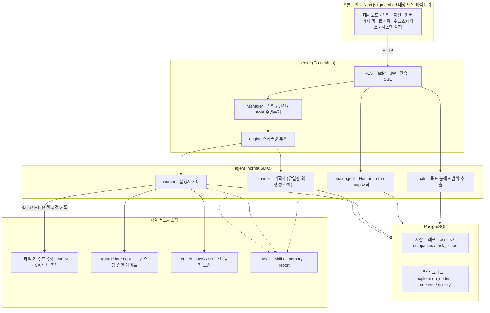
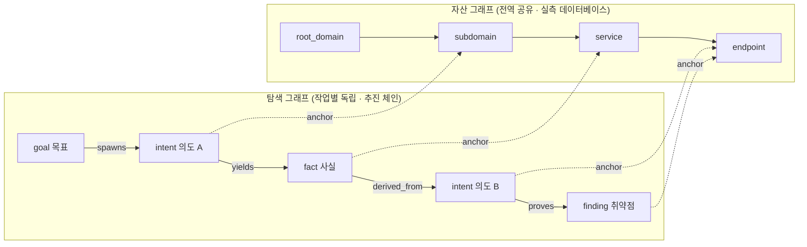
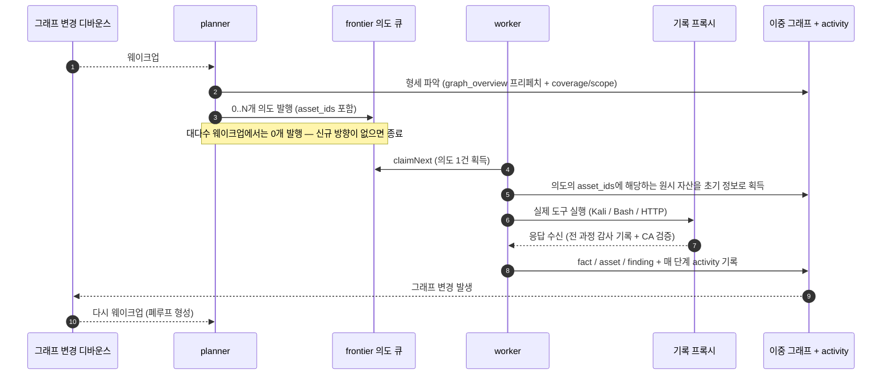
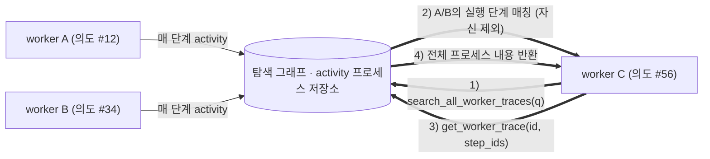
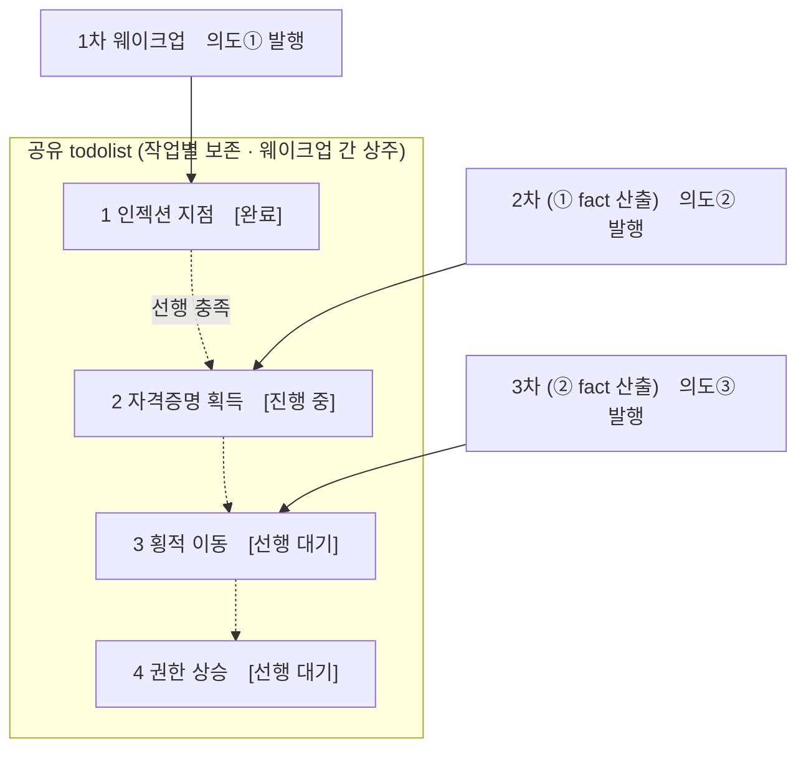

<div align="center">

# ARTEX

AI 에이전트 기반 자율 침입탐지 및 모의침투 시스템 (Go 백엔드 + Next.js 프론트엔드)


🌐 **온라인 데모**: [https://artex-demo.vercel.app/](https://artex-demo.vercel.app/)

</div>

---

## 스크린샷 미리보기

> 전체 인터랙션은 [온라인 데모](https://artex-demo.vercel.app/)에서 확인하실 수 있습니다.

| 대시보드 (전체 개요 / 토큰 소모 / 활동 스트림) | 작업 목록 |
| :---: | :---: |
|  |  |

| 작업 · 실행 과정 (세션 / 도구 호출) | 탐색 체인 |
| :---: | :---: |
|  |  |

| 발견 사항 | 자산 |
| :---: | :---: |
|  |  |

| 자산 커버리지 맵 (포스 유도 레이아웃 · 테스트 완료 강조 · 노드 접기/펼치기) |
| :---: |
|  |

| 트래픽 기록 | Human-in-the-Loop 대화 |
| :---: | :---: |
|  |  |

| Agent 관리 | LLM 설정 |
| :---: | :---: |
|  |  |

| 인터셉트 승인 | 백엔드 로그 |
| :---: | :---: |
|  |  |


---

## 승인 기록 상세

전역 「승인 기록」, 작업 내 「인터셉트 승인」 및 대화 중의 승인 카드는 모두 펼쳐서 상세 내용을 확인할 수 있습니다. 표시 구조는 [AegisHook의 승인 상세 컴포넌트](https://github.com/RuoJi6/AegisHook/blob/main/web/src/components/CallDetail.vue)를 참조하였으며, ARTEX의 컴포넌트와 테마를 유지합니다:


## 자산 동기화 (ScopeSentry)

[ScopeSentry](https://github.com/Autumn-27/ScopeSentry)에서 자산 데이터를 직접 동기화할 수 있어 중복 수집을 방지합니다:

- 「**자산 동기화**」 페이지에서 ScopeSentry 주소와 API Key를 입력하여 데이터 소스를 연동합니다.
- **프로젝트** 또는 **작업** 단위로 동기화할 대상 및 자산 유형(도메인 / 서브도메인 / IP / 포트 / 사이트 / 엔드포인트…)을 선택합니다.
- 클릭 한 번으로 가져와 조직 자산 범위에 맞춰 병합하며, ARTEX의 자산 그래프에 직접 반영되어 agent 탐색에 활용됩니다.

---

## 설치

> 데이터베이스 **PostgreSQL**이 필요합니다. 탐색을 위해 **LLM** 설정(`ANTHROPIC_API_KEY` 또는 `OPENAI_API_KEY`, UI에서도 설정 가능)이 필요합니다.

### 방법 1: 원클릭 설치 스크립트 (권장)

```bash
git clone https://github.com/Hinln/ARTEX.git
cd ARTEX
./install.sh
```

스크립트 동작 과정: Docker 감지 및 자동 설치 → **① 전체 Docker** 또는 **② 로컬 컴파일 실행** 중 선택:

- **① 전체 Docker**: Postgres 비밀번호 입력(엔터 입력 시 랜덤 생성) → `.env` 자동 작성 → `docker compose up -d`.
- **② 로컬 실행**: 데이터베이스 선택(기존 DB 연결 / Docker로 실행) → `config.json` 생성 → `go` 웹 UI 내장 단일 바이너리 컴파일 → 실행.

설치 완료 후 **http://localhost:8787** 접속 (최초 접속 시 `/setup`에서 관리자 비밀번호 설정).

### 방법 2: Docker Compose (수동)

```bash
git clone https://github.com/Hinln/ARTEX.git
cd ARTEX
cp .env.example .env          # POSTGRES_PASSWORD 입력, 선택 사항: ANTHROPIC_API_KEY
docker compose up -d          # autumn27/artex 이미지 + postgres 풀링
# → http://localhost:8787
```

이미지에는 자주 사용되는 도구(ripgrep/curl/vim/npm/nmap…)가 이미 포함되어 있으며, `./skills`와 `./data`는 바인드 마운트로 영구 보존됩니다.

원격 MCP는 시스템 설정에서 `http`(Streamable HTTP) 또는 `sse`(레거시 SSE)를 선택할 수 있습니다.
레거시 SSE 서비스는 통상 `GET /sse`로 이벤트 스트림을 생성한 후, 서비스가 반환한 `/message?sessionId=...`를 통해 JSON-RPC 요청을 수신합니다. 설정 시 URL에 `/sse`를 입력하고, 요청 헤더는 `Authorization=Bearer <token>` 형식으로 입력합니다.

### 방법 3: 사전 컴파일 바이너리 다운로드 (Releases)

[Releases](https://github.com/Hinln/ARTEX/releases)에서 해당 플랫폼에 맞는 zip을 다운로드하고 압축을 풀면 `artex` + `start.sh`(Windows의 경우 `start.bat`) + `skills/` + `config.example.json`이 제공됩니다:

```bash
cp config.example.json config.json   # database 연결 정보 입력
./start.sh                           # → http://localhost:8787
```

> `./artex`를 직접 실행하지 말고 `start.sh` / `start.bat`을 통해 실행하세요. 이 스크립트는 데몬 스크립트 역할을 하여 프로그램 종료 후 종료 코드에 따라 재시작 여부를 결정하며, **웹 UI 상의 [원클릭 업데이트](#방법-1-웹-ui-원클릭-업데이트-권장)가 이 스크립트를 통해 바이너리 교체를 완료**합니다. `./artex`를 직접 실행하면 업데이트 후 재시작되지 않습니다.
> 백그라운드 상주 실행: `nohup ./start.sh >artex.log 2>&1 &`

### 방법 4: 소스코드에서 단일 바이너리 컴파일

```bash
# 1) 프론트엔드 정적 내보내기 (Export)
cd web && npm ci && npm run build:static && cd ..
# 2) 내장 디렉토리로 복사
cp -r web/out server/webui/dist
# 3) 컴파일 (-tags embedui 플래그가 있어야 프론트엔드가 내장됨)
CGO_ENABLED=0 go build -tags embedui -o artex ./cmd/artex
./start.sh
```

### 방법 5: 크로스 플랫폼 Release 압축 파일 빌드

`build.sh`는 프론트엔드를 먼저 빌드하여 내장한 뒤, Go 링커로 디버깅 정보를 제거하고 릴리즈 파일을 zip으로 압축합니다. Release 모드는 기본적으로 Linux amd64/arm64, macOS amd64/arm64, Windows amd64용 zip 패키지를 생성합니다:

```bash
./build.sh --release
# 생성 결과물: dist/artex-0.3.3-*.zip
```

UPX 자체 압축 바이너리는 일부 Linux 커널, 가상화 환경 또는 보안 정책과 충돌할 수 있어 기본적으로 비활성화되어 있습니다. `ARTEX_TARGETS`로 타깃을 커스텀할 수 있으며, 타깃 런타임 환경의 호환성이 확인된 경우 `--upx`를 명시적으로 전달하여 바이너리 크기를 더욱 줄일 수 있습니다:

```bash
ARTEX_TARGETS=linux/amd64,windows/amd64 ./build.sh --release
./build.sh --target linux/amd64 --upx
```

---

## 업데이트 및 업그레이드

> 업그레이드는 프로그램만 교체하고 데이터는 유지됩니다: Postgres 데이터 볼륨 `pgdata`, `./data` (jwt.key / SQLite 등), `./skills`는 모두 보존됩니다. **데이터베이스 마이그레이션은 수동으로 실행할 필요가 없습니다** — `artex`는 시작할 때마다 `schema.sql`(`ADD COLUMN` / `CREATE INDEX IF NOT EXISTS` 포함)을 멱등하게 재실행하므로 "재시작이 곧 마이그레이션"입니다. 업그레이드 전 `./data`와 데이터베이스 백업을 권장합니다.

### 본 저장소의 프라이빗 Release 업데이트 소스

웹 UI 원클릭 업데이트는 고정적으로 [Hinln/ARTEX Releases](https://github.com/Hinln/ARTEX/releases)에서 버전을 확인하고 다운로드합니다. 소스코드를 클론하거나 Git을 통해 업데이트할 때도 `Hinln/ARTEX`를 사용하며, 원본 프로젝트의 Go module 경로는 그대로 유지됩니다.

본 저장소는 프라이빗 저장소입니다. ARTEX를 실행하는 백엔드 프로세스에 `ARTEX_UPDATE_GITHUB_TOKEN`을 설정해 주세요. 토큰에는 본 저장소에 대한 **Contents: read** 권한만 있으면 됩니다. 토큰은 백엔드가 Release를 조회하고 첨부파일을 다운로드하는 데 사용되며 브라우저로 전송되지 않고 Git에 커밋해서도 안 됩니다.

```bash
# 현재 shell 또는 서비스 환경에서 ARTEX_UPDATE_GITHUB_TOKEN을 안전하게 설정한 후 실행
./start.sh
```

로컬에서 직접 실행할 경우 `start.sh`는 `.env`를 자동으로 읽지 않으므로 프로세스 환경에 변수를 export 해야 합니다. Docker Compose 배포의 경우 Git에 추적되지 않는 `.env`에 해당 변수를 작성하고 artex 컨테이너를 재생성하면 됩니다. 이미지는 본 브랜치의 업데이트 코드를 포함하고 있어야 하며, 구버전 이미지는 이로 인해 업그레이드 소스가 변경되지 않습니다.

본 저장소에서 draft나 prerelease가 아닌 정식 Release를 발행하고 `artex-<버전>-<os>-<arch>.zip` 및 `SHA256SUMS`가 첨부되어 있어야 웹 UI에서 설치 가능한 업데이트를 제공할 수 있습니다. 저장소에 소스코드만 있는 상태에서는 온라인 업그레이드가 불가능합니다. 기존 Release 워크플로는 `v*` 태그를 푸시할 때 현재 저장소용 첨부파일을 자동으로 생성합니다.

### 방법 1: 웹 UI 원클릭 업데이트 (권장)

**시스템 설정** 페이지(사이드바 「시스템 설정」 → `/system/settings`)의 **버전 및 업데이트** 카드에서 서버에 로그인할 필요 없이 새 버전을 직접 확인하고 설치할 수 있습니다.

「업데이트」를 클릭하면: 현재 플랫폼의 릴리즈 패키지 다운로드 → Release의 `SHA256SUMS` 대조 검증 → `-h` 플래그로 새 바이너리 스모크 테스트 수행 → `artex.new`로 임시 저장 → 프로그램 종료 후 `start.sh` / `start.bat`이 새 버전으로 교체하여 재시작합니다. 웹 페이지는 새 버전이 온라인 상태가 될 때까지 대기한 후 자동으로 새로고침됩니다.

- **실패 시 문제가 있는 바이너리를 남기지 않음**: 검증이나 스모크 테스트 실패 시 임시 파일을 폐기하고 현재 버전을 계속 실행합니다. 교체 후 새 버전이 3회 연속 시작 실패할 경우 자동으로 `artex.old`로 롤백됩니다(실패한 바이너리는 분석을 위해 `artex.failed`로 보존).
- **언제든 롤백 가능**: 이전 버전은 `artex.old`로 유지되며, 카드에 「이전 버전으로 롤백」 버튼이 제공됩니다. 단, 데이터베이스 구조는 롤백되지 않습니다.
- **업데이트 시 실행 중인 작업이 중단됨**: 업데이트는 곧 재시작을 의미하므로 작업이 없는 유휴 상태에서 진행하세요.
- **개발 빌드는 업데이트 불가**: 버전 번호가 `dev`이거나 `git describe`에 접미사가 붙은 경우 로컬 디버깅 바이너리가 정식 버전으로 덮어써지는 것을 방지하기 위해 업데이트가 비활성화됩니다.
- **Docker 환경에서는 프로그램만 교체되고 이미지는 교체되지 않음**: 이미지 내의 playwright / nmap 등 도구 체인은 함께 업그레이드되지 않으며, `docker compose up -d`로 컨테이너를 재생성하면 이미지가 가지고 있던 원래 버전으로 되돌아갑니다. 이미지까지 함께 업그레이드하려면 여전히 `docker compose pull artex && docker compose up -d artex`를 사용하세요.
- GitHub 접근에 프록시가 필요한 경우 동일 페이지에서 **글로벌 프록시**를 설정하면 업데이트 파이프라인도 해당 프록시를 경유합니다. 업데이트는 GitHub 도메인에서만 다운로드되며 HTTPS가 강제됩니다.

### 방법 2: 원클릭 업데이트 스크립트

```bash
cd ARTEX
./update.sh
```

스크립트는 먼저 `git pull`로 최신 코드를 가져올지 선택한 후, **① Docker 업데이트** 또는 **② 로컬 컴파일 업데이트**를 선택할 수 있게 합니다 (`install.sh`와 대응):

- **① Docker**: 대상 이미지 태그 지정 가능(엔터 입력 시 `.env`의 `ARTEX_TAG` 유지, 기본값 `latest`) → `docker compose pull` → `docker compose up -d` (새 이미지로 교체 후 재시작 시 자동 마이그레이션).
- **② 로컬**: 프론트엔드 정적 결과물 재생성 → `./artex` 재컴파일 (완료 후 프로세스 재시작 시 반영).

### 방법 3: Docker Compose (수동)

```bash
cd ARTEX
git pull                       # compose / 스크립트 업데이트 (선택 사항)
# 버전 지정: .env에 ARTEX_TAG=v0.2.0 설정; 미설정 시 latest 사용
docker compose pull artex
docker compose up -d artex     # 새 이미지로 교체 후 재시작 → schema 자동 마이그레이션
docker image prune -f          # 이전 이미지 정리 (선택 사항)
```

### 방법 4: 사전 컴파일 바이너리 (Releases)

[Releases](https://github.com/Hinln/ARTEX/releases)에서 새 버전 zip을 다운로드하고, 기존 프로세스를 중지한 뒤 `artex`와 `skills/`를 덮어씁니다(`config.json`과 `data/`는 보존). 이후 재시작합니다:

```bash
cp -r <압축해제디렉토리>/skills ./ && cp <압축해제디렉토리>/artex ./
./start.sh
```

### 방법 5: 소스코드에서 컴파일

```bash
git pull
cd web && npm ci && npm run build:static && cd ..
cp -r web/out server/webui/dist
CGO_ENABLED=0 go build -tags embedui -o artex ./cmd/artex
# ./start.sh 재시작
```

---

## 설정

**데이터베이스** (`config.json` 또는 환경변수 `ARTEX_PG_DSN`으로 재정의):

```json
{
  "database": {
    "host": "127.0.0.1", "port": 5432,
    "user": "artex", "password": "yourpass",
    "dbname": "artex", "sslmode": "disable"
  }
}
```

**LLM**: `export ANTHROPIC_API_KEY=sk-...` (또는 `OPENAI_API_KEY`), UI의 「LLM 설정」 페이지에서도 입력 가능.
선택 사항: `ARTEX_LLM_PROVIDER` / `ARTEX_LLM_MODEL` / `ARTEX_LLM_BASE_URL` / `ARTEX_LLM_PROXY`.

**동시성**: 작업별 work agent 수는 「시스템 설정」에서 설정 가능 (기본값 3).

**자주 사용하는 파라미터**: `./start.sh -addr :8787 -proxy :8788` (`-addr`: 프론트엔드+API, `-proxy`: 트래픽 기록 프록시). 시작 스크립트는 전달된 인수를 그대로 `artex`에 전달합니다.

### 리버스 프록시 배포 (HTTPS / 443 포트만 오픈)

프론트엔드와 API/SSE는 모두 동일한 백엔드 포트(기본값 `:8787`)에서 제공되며, 실시간 활동 스트림은 기본적으로 **동일 오리진(Same-Origin)** 주소를 사용하므로 **`NEXT_PUBLIC_SSE_BASE`를 별도로 설정할 필요가 없습니다**. 공용 네트워크에는 443 포트만 열어두고 8787은 내부망에 유지하면 됩니다.

SSE는 지속 연결(Long-polling) + 스트리밍 푸시 방식이므로, 리버스 프록시에서 **반드시 버퍼링을 꺼야 합니다**. 그렇지 않으면 브라우저는 연결되었으나 이벤트를 수신하지 못하는 현상(활동 스트림에 로딩 스피너만 계속 도는 현상)이 발생합니다. Nginx 설정 예시:

```nginx
server {
    listen 443 ssl;
    server_name your.domain.com;
    # ssl_certificate / ssl_certificate_key ...

    location / {
        proxy_pass http://127.0.0.1:8787;
        proxy_set_header Host $host;
        proxy_set_header X-Forwarded-Proto $scheme;

        # SSE 핵심 설정: 버퍼링 해제, 타임아웃 연장, HTTP/1.1
        proxy_buffering off;
        proxy_cache off;
        proxy_read_timeout 3600s;
        proxy_http_version 1.1;
        proxy_set_header Connection "";
    }
}
```

> SSE가 웹 페이지와 다른 오리진(예: 별도 서브도메인)을 경유해야 하는 경우에만 **빌드 시점**에 `NEXT_PUBLIC_SSE_BASE`를 설정하세요(이 변수는 `next build` 시 정적 패키지에 고정되므로 컨테이너 런타임에 설정해도 적용되지 않습니다).

---

## 개발

### 수동 취약점 재검증 (Retest)

작업 상세의 「재검증」 탭에서 해당 작업의 취약점을 페이지별로 선택하고 과거 결론과 증거를 조회하며, 수동으로 재검증을 실행할 수 있습니다. 실행 후 현재 탭이 유지되며 로딩 아이콘과 함께 「재검증 중」이 표시됩니다. 조치 완료가 확인되면 취약점 상태가 동기화되어 업데이트됩니다.

취약점 목록 각 행의 조작 영역에서 「재검증」을 클릭하거나, 취약점 상세의 「취약점 재검증」 영역에서 「재검증 시작」을 클릭하고 선택 사항인 수정 버전, 테스트 조건 또는 제한 사항을 입력하면 시스템이 독립적인 재검증 Agent 세션을 생성하며 시작 후 현재 페이지가 유지됩니다. 목록의 기본 보기, 작업별 그룹화 보기 및 자산 뷰 모두 이 진입점을 지원합니다. 재검증 실행 중에는 로딩 아이콘과 함께 「재검증 중」이 표시되며, 조회가 필요할 때 클릭하여 해당 세션으로 진입할 수 있고 종료 후 다시 「재검증」 버튼으로 복원됩니다. 재검증은 원래의 스캔 작업을 다시 시작할 필요가 없으며, 결론은 「재현 가능」, 「조치 완료」, 「확인 불가」로 나뉩니다. 매회의 결론, 증거 및 세션 링크는 취약점 상세에 저장됩니다.

새 버전 백엔드가 처음 시작될 때 편집 가능한 「취약점 재검증」(`retester`) Agent가 기본 등록되며, Agent 관리에서 프롬프트, LLM, 실행 예산 및 도구를 설정할 수 있습니다. 기본적으로 바인딩된 LLM을 사용하며 미바인딩 시 전역 활성화 설정을 사용합니다. 재검증 세션이 성공적으로 완료되고 결론이 「조치 완료」인 경우 시스템은 자동으로 취약점 조치 상태를 「조치 완료」로 변경합니다. 실행 중, 실패, 중지 또는 기타 결론인 경우 기존 상태가 유지됩니다. 원본 증거와 보고서는 항상 보존됩니다. 상태 드롭다운 메뉴에서 수동으로 「조치 완료」를 선택할 수도 있습니다. 동일 취약점이 이미 재검증 중인 경우 기존 세션을 재사용하며, 중지/실패 또는 서비스 재시작 후 다시 시작할 수 있습니다.

본 버전의 이력 기록은 취약점 상세 및 세션을 통해 조회할 수 있으며, 취약점 보고서 내보내기나 작업 아카이브 패키지에는 아직 포함되지 않았고 트래픽 패킷과도 자동 연동되지 않습니다. 데모 모드에서는 명확히 표시된 시뮬레이션 기록만 생성되며 실제 대상에 요청을 보내지 않습니다.

### 로컬 실행 및 테스트

```bash
./dev.sh    # 백엔드(:8787) + 트래픽 프록시(:8788) + 프론트엔드 next dev(:5173) → http://localhost:5173
```

- 백엔드: `go run ./cmd/artex` (`-tags embedui` 미포함 시 프론트엔드가 내장되지 않음)
- 프론트엔드: `cd web && npm run dev` (`/api`를 백엔드로 프록시, 핫 리로딩 지원)
- 테스트: `go test ./...`
- Mock 미리보기 (백엔드 불필요): `cd web && NEXT_PUBLIC_MOCK=1 npm run dev`

---

## 시스템 기술 아키텍처

ARTEX는 **LLM 다중 에이전트 구동 기반의 자율 침입탐지 및 모의침투 시스템**입니다: Go 모놀리식 백엔드 (Next.js 프론트엔드 내장) + PostgreSQL 기반이며, 에이전트 역량은 [`norma`](https://github.com/Autumn-27/norma) SDK(`agentcore` / `tool` / `permission` / `harness` / `memory` / `transcript`)를 통해 제공됩니다.
핵심은 **이중 그래프(Dual-Graph) 아키텍처**이며, 이를 둘러싼 두 가지 자율성 메커니즘인 **worker 간 프로세스 레벨 정보 교환**과 **planner 다중 라운드 공유 todolist 기반의 안정적인 공격 체인**입니다.

### 전체 아키텍처 계층



| 계층 | 역할 및 책임 |
| --- | --- |
| **프론트엔드** | Next.js 정적 내보내기, `go:embed`로 단일 바이너리에 내장; 작업/자산/탐색 체인/커버리지 맵 시각화, Human-in-the-Loop 대화 인터페이스 제공 |
| **server** | `net/http` 라우팅 + JWT 인증 + SSE; `Manager`를 통해 작업, 엔진, DB store의 수명주기 관리 |
| **engine** | 작업당 하나의 `plannerLoop` + N개의 worker goroutine; 의도(Intent) 획득, 타임아웃/일시정지/드레인 제어 |
| **agent** | goals / planner / worker / mainagent, `ToolSet`을 통해 이중 그래프를 LLM 도구로 노출 |
| **db** | 이중 그래프의 Postgres 저장소(pgx); 스키마는 `go:embed`를 통해 시작 시마다 멱등하게 테이블 생성 |
| **지원 서브시스템** | 기록형 MITM 프록시, 도구 승인 게이트, 비동기 데이터 보강, MCP/스킬/메모리/보고서 생성 |

### 이중 그래프 아키텍처: 탐색 그래프 + 자산 그래프

시스템은 「**목표가 무엇인가**」와 「**어디까지 점검/테스트되었는가**」를 상호 독립적이면서도 앵커(Anchor)를 통해 연결된 두 개의 그래프로 분리합니다:

- **자산 그래프 (Asset Graph, 전역 공유)**: 작업 간 공유되는 자산의 실측 데이터베이스(Truth Store)입니다. 노드는 `root_domain / subdomain / ip / service / app / endpoint`이며 조직에 귀속됩니다. 도메인→서브도메인→서비스→엔드포인트의 부모-자식 관계와 중복 제거 키는 프로그램이 계산하며, agent는 원시 정보만 제출합니다.
- **탐색 그래프 (Exploration Graph, 작업별 독립)**: 개별 작업의 "추론 및 진행" 프로세스입니다. 노드는 `goal(목표) / intent(의도) / fact(사실) / finding(취약점) / hint(힌트)`로 구성되며, `spawns / derived_from / yields / proves` 등의 에지로 연결되어 **계보 체인(Lineage Chain)**을 형성하여 "어떤 방향이 어떤 사실에서 파생되었고 무엇을 산출했는지"를 추적합니다.
- **앵커를 통한 두 그래프의 연결**: `exploration_anchors(node_id, asset_id)`가 의도/사실/취약점을 구체적인 자산에 고정합니다. 따라서 "탐색 방향"의 관점에서 어떤 자산을 대상으로 하는지 확인할 수 있을 뿐 아니라, "특정 자산"의 관점에서도 본 작업에서 어떤 의도에 의해 점검되었고 어떤 사실이 도출되었는지 역추적할 수 있습니다. 이는 **자산 테스트 커버리지** 및 **자산 커버리지 맵**(범위 내 자산 + 테스트 완료 강조)을 뒷받침합니다.



> 역할 분담: **planner**는 탐색 그래프의 전체 형세를 읽고 목표를 판단하여, 아직 커버되지 않은 새로운 방향이 있을 때만 **의도(intent)**를 frontier 큐에 발행합니다. **worker**는 **하나의 의도**를 가져가 실제 도구로 실행한 뒤 새 자산/사실/취약점을 두 그래프에 기록하고 종료합니다. 자산 그래프는 공유된 사실이며 탐색 그래프는 각 작업의 추진 체인입니다.

### 엔진과 의도(Intent) 생명주기 (단일 탐색의 폐루프)

엔진은 **이벤트 기반**의 폐루프(Closed Loop)로 구동됩니다: 그래프가 변경되면 planner를 깨우고, planner가 의도를 발행하며, worker가 의도를 받아 실행 후 기록합니다. 이 기록이 다시 다음 라운드를 트리거하며 목표가 증명(`prove_goal`)될 때까지 반복됩니다.



### worker 간 프로세스 레벨 정보 교환

깊이 있는 탐색 과정에서 수많은 가치 있는 관찰(에러 메시지, 특정 응답, 숨겨진 파라미터 등)이 특정 worker의 **실행 과정**에 나타나지만 공식적인 fact로 기록되지 않을 수 있습니다. 중복 작업을 방지하고 체인 상의 worker들이 서로의 성과를 활용할 수 있도록 worker는 **작업 간 프로세스 검색** 능력을 갖추고 있습니다:

- `search_all_worker_traces(q)`: **본 작업의 다른 worker 실행 과정**에서 키워드로 검색(자신의 의도에 해당하는 단계는 자동 제외), 매칭 항목에 `intent_id` 포함.
- `list_worker_traces` / `get_worker_trace(intent_id, step_ids=[…])`: 먼저 어떤 작업들이 수행되었는지 확인한 후, 특정 작업의 세부 단계 전체 내용을 가져와 상세 정보를 교환.

이를 통해 탐색 그래프 상에 아직 공식적인 fact가 없더라도 후속 worker가 이전 관찰 내용을 재사용할 수 있습니다. 즉, **정보가 worker 간에 "실행 과정" 단위로 유연하게 흐르되**, 경계는 유지됩니다(각 worker는 자신이 할당받은 의도만 수행).



### planner 다중 라운드 공유 todolist → 안정적인 공격/탐색 체인

실제 침투/공격 체인은 대개 **선후 의존성이 있는 다단계 시퀀스**입니다 (예: 인젝션 취약점 발견 → 자격 증명 획득 → 횡적 이동 → 권한 상승). 이를 한 번에 병렬로 배포하면 충돌과 혼선이 발생합니다. 따라서 planner는 **작업별로 보존되며 웨이크업 간에 공유되는 계획 할 일 목록(todolist)**을 유지합니다:

- planner는 이벤트 기반으로 동작하여 그래프가 변경될 때마다 깨어나지만, **매 웨이크업은 완전히 새로운 세션(Stateless)**입니다. 공유 todolist를 통해 직렬 공격 체인을 **한 번 기록**한 뒤, 후속 다중 라운드에서 **의존성에 따라 단계적으로 의도를 발행**할 수 있으며, 전체 체인을 한 라운드에 무리하게 전개하지 않습니다.
- 매 라운드마다 「선행 단계가 완료되고 필요한 fact가 이미 확보된」 다음 단계에 대해서만 의도를 발행하며, 진행 상황에 따라 목록을 갱신합니다(fact로 충족된 단계를 완료 처리).



따라서 공격/탐색 체인은 "이벤트 기반 + 상태 없는(Stateless) 세션" 환경에서도 **중복 없이, 순서 착오 없이 안정적으로 전진**할 수 있으며, 이것이 ARTEX가 다단계 침투 체인을 자율적으로 완주할 수 있는 핵심 메커니즘입니다.

---

## 커뮤니티

WeChat 공식 계정 **SecSentry**를 팔로우하고 메시지를 보내 소통 그룹에 참여할 수 있습니다.

<div align="center">


</div>

---

## 참고

https://github.com/oritera/Cairn

---

## 라이선스 및 면책 조항

### 오픈소스 라이선스

본 프로젝트는 **GNU Affero General Public License v3.0 (AGPL-3.0)**에 따라 라이선스가 부여되며 전체 조항은 저장소 루트의 [LICENSE](LICENSE) 파일에서 확인할 수 있습니다.

누구나 본 프로젝트를 자유롭게 사용, 수정 및 배포할 수 있으나, **파생 저작물 또한 동일하게 AGPL-3.0으로 공개되어야 합니다**. 특히, **본 프로젝트를 수정하여 네트워크를 통해(예: 온라인 서비스 배포) 사용자에게 제공하는 경우에도 해당 사용자에게 완전한 소스코드를 공개해야 합니다**.

> ⚠️ **중요 안내**: 오픈소스 라이선스 자체는 소프트웨어의 사용 용도를 제한하지 않습니다. 아래의 「사용 제한」 및 「면책 조항」은 원저작자가 사용자에게 요구하는 추가적인 약정이자 엄중한 선언이므로 반드시 준수해야 합니다.

**ARTEX는 개인 학습, 코드 연구 및 로컬 환경에서의 기술 검증 목적으로만 사용되어야 하며, 실제 온라인 시스템이나 웹사이트를 대상으로 침투 테스트 또는 공격을 수행하는 데 사용될 수 없습니다.**

### 허용 사용 범위

- **본 프로젝트 소스코드의 열람, 학습 및 연구**, 그리고 **로컬 격리 환경**에서의 기술 원리 검증에만 사용할 수 있습니다.
- 개인 학습, 학술 연구, 코드 리뷰 등 비공격적 용도에 적합합니다.

### 금지 사항

- **인가 여부나 자체 자산 여부와 무관하게, 본 도구를 사용하여 어떠한 웹사이트, 온라인 서비스 또는 네트워크 시스템에 대해서도 스캔, 탐지, 취약점 공격(Exploit)을 수행하는 행위를 엄격히 금지합니다.**
- 본 도구를 실제 침투 테스트, 레드팀/블루팀 공방 대항전 또는 프로덕션 환경에 투입하는 행위를 엄격히 금지합니다.
- 본 도구를 불법 침입, 데이터 탈취, 랜섬웨어/공갈, 서비스 거부(DoS) 공격 또는 일체의 파괴적/범죄적 활동에 사용하는 행위를 엄격히 금지합니다.
- 거주 또는 운영 중인 국가/지역의 법률 및 규정을 위반하는 활동에 본 도구를 이용하는 행위를 엄격히 금지합니다.

### 준법 책임

사용자는 사이버 보안, 데이터 보호 및 컴퓨터 범죄와 관련된 해당 국가/지역의 모든 법률 및 규정을 준수할 전적인 책임이 있습니다. **본 도구의 사용으로 인해 발생하는 모든 법적 책임과 결과는 전적으로 사용자가 부담합니다.**

### 면책 조항

본 프로젝트는 "있는 그대로(AS IS)" 제공되며, 명시적이거나 묵시적인 어떠한 보증도 제공하지 않습니다. 원저작자 및 기여자는 본 도구의 사용(적절한 사용 여부 불문)으로 인해 발생하는 어떠한 직접적·간접적 손실, 데이터 손실, 시스템 손상 또는 법적 분쟁에 대해서도 책임을 지지 않습니다. **본 프로젝트를 다운로드, 설치 또는 사용하는 것은 위의 모든 조항을 읽고 이해했으며 이에 동의한 것으로 간주됩니다.**
